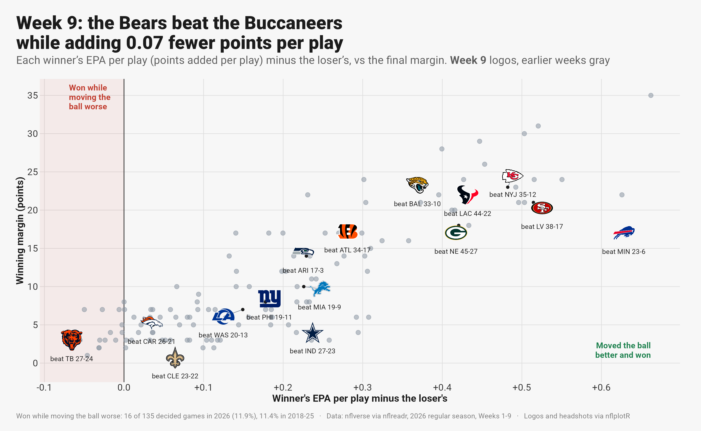
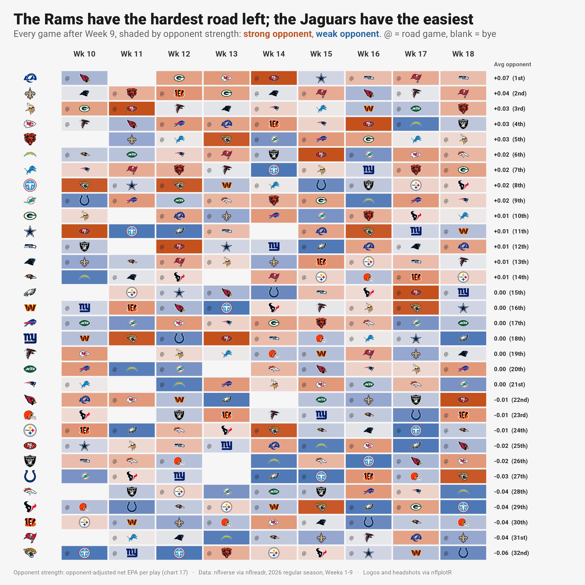
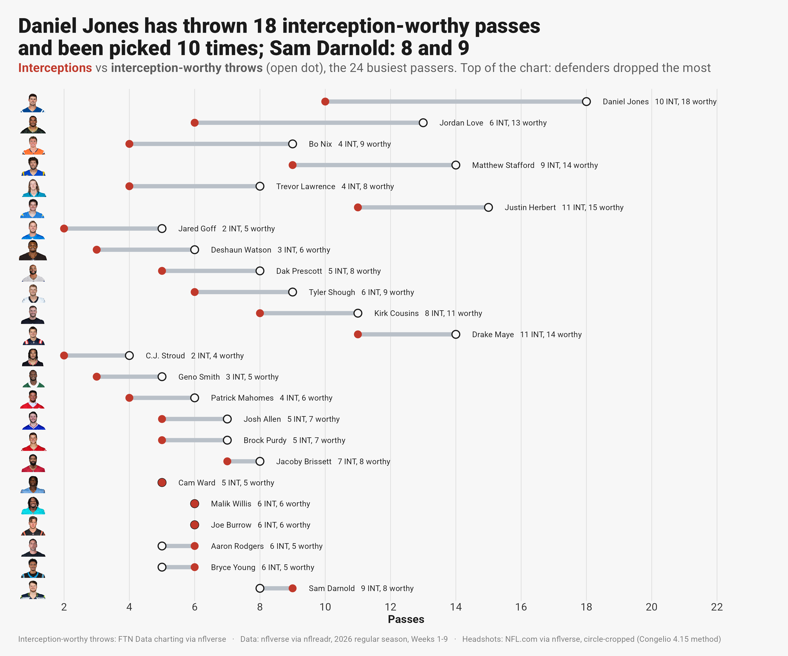
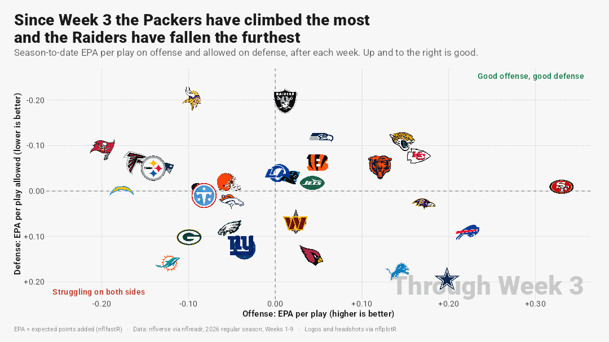

# NFL advanced metrics, visualized

Fifty-nine charts and one animation of the 2026 NFL season, a week-by-week set rebuilt every Tuesday, and patterns across
2018-2025, built in R from nflverse data. Each one is
meant to be read in five seconds: the title states the finding, a one-line subtitle says what is measured, and team logos
or player headshots replace legends. Titles are computed from the data, so a rerun after next week keeps them true. The
style follows Bradley Congelio's *Introduction to NFL Analytics with R* (chapter 4), rebuilt on the current nflverse and
ggplot2 4 APIs.

Data through 2026 Week 9. Rebuild everything with one command (`scripts/build_all.sh`), or only the week-by-week charts
(`scripts/build_week.sh`).


## What the charts say

- **Caleb Williams went from 30th to 14th to 6th in EPA per dropback** over three seasons, and is 3rd in completion
  percentage over expected. Only Joe Burrow beats him on both (B1, B2). His sack rate went 9.9%, 3.8%, 6.2% (B7).
- **Ben Johnson fixed third down:** the Bears went from 31st in 2024 to 8th in his first season, and are 5th now (B8).
  The defense is the mirror image: 1st in third-down stops, 29th in yards per play allowed (B9).
- **Touchdown luck doesn't carry over; opportunity does.** Scoring more than expected in Weeks 1-8 says almost nothing
  about Weeks 9-18 (r = 0.04); expected touchdowns do (r = 0.44). 1,159 player-seasons (P2).
- **Three weeks explain only 18%** of how a team plays the rest of the season (r = 0.42, 256 team-seasons) (P3).
- **The new kickoff gave every offense about 5 free yards:** drives start at the 30 instead of the 25, and 58-60% cross
  midfield instead of 53% (P1, 22,198 drives).
- **Record vs performance:** the Broncos (7-2) have 2.2 more wins than their points say and the Buccaneers (3-6) have 2.2
  fewer (16). Adjusting for opponents moves the Falcons from 24th to 17th in net EPA per play and the Giants from 13th
  to 20th (17). The Rams have the hardest remaining schedule and the Jaguars the easiest (18).
- **The Jaguars are top-10 on all 12 offensive and defensive measures** in the rank grid (31). The 49ers score a
  touchdown on 39% of drives and 85% of red-zone trips (19, 21).
- **The Vikings blitz on 67% of dropbacks,** more than double the league average, and lead the league in pressure rate at 34% (23).
- **Interception luck:** Daniel Jones has thrown 18 interception-worthy passes and been picked 10 times; Sam Darnold has
  9 interceptions on 8 (26). Caleb Williams holds the ball longest of any regular starter, 3.19 seconds a throw (25).
- **2026 movers:** from Weeks 1-3 to Weeks 7-9, the Packers went from 31st to 6th in net EPA per play, the Giants from
  29th to 5th and the Buccaneers from 26th to 3rd; the Ravens fell from 7th to 31st and the Raiders from 4th to 28th (T4).
- **Who controls games:** the 49ers have led for 69% of their game time and the Chargers for 13% (W3). 16 of 135 decided
  games went to the team that moved the ball worse, close to the 2018-25 rate of 11.4% (W1).
- **Injuries drive role changes:** 10 of the 12 biggest snap-share risers are filling in for a teammate who is out or gone
  (W5), and the Eagles have been missing a starter 30 times since Week 2 (W6).
- **Wind takes the deep ball away:** at 16+ mph a throw 20+ yards downfield is worth 0.16 EPA, 64% less than in calm air,
  yet teams throw deep just as often (P4, 2018-2026).

## Charts

**Chicago Bears and Caleb Williams**

| # | Finding |
|---|---|
| B1 | 30th (2024) to 14th (2025) to 6th (2026) in EPA per dropback |
| B2 | Only Joe Burrow is both more efficient and more accurate (circle headshots) |
| B3 | He keeps every receiver involved; Rome Odunze turns targets into the most EPA |
| B4 | He beats expected completion at every depth of throw |
| B5 | D'Andre Swift gets the carries; Kyle Monangai does more with them |
| B6 | Every 2026 game with the starting quarterback: 5-1 with Caleb |
| B7 | Sack rate by season |
| B8 | Third downs by head coach, 2018-2026 |
| B9 | Defensive rank on six measures |

**Week by week (W1-W10, rebuilt every Tuesday; the title carries the week)**

| # | Finding |
|---|---|
| W1 | Every game by its winner: did the team that moved the ball better win? |
| W2 | The 10 plays that swung win probability most, with the player who made each one |
| W3 | Share of game time each team has led, tied and trailed, game by game |
| W4 | Next week's games: each offense's rank against the rank of the defense it faces |
| W5 | The biggest snap-share risers, and whether they are filling in for a teammate |
| W6 | Starters who did not play, by week and by reason |
| W7 | Division races: games over .500 after each week |
| W8 | Each team's quarterback this week against his own season |
| W9 | What each defense allows to wide receivers, tight ends and running backs |
| W10 | Penalty yards per game, before the snap and during the play |

**How teams have trended in 2026**

| # | Finding |
|---|---|
| T1 | The first half of the season so far vs the second: the 8 biggest risers and fallers |
| T2 | Today's best 8 and worst 8, and how each got there on offense and defense |
| T3 | Every team's season, game by game, with a three-game rolling line |
| T4 | Rank in three stretches of the season, one panel per team |

**Luck, schedule and situations (16-32)**

| # | Finding |
|---|---|
| 16 | Wins vs wins expected from points scored and allowed (Pythagorean), all 32 teams |
| 17 | Net EPA per play before and after adjusting for opponents (ridge regression) |
| 18 | Every remaining game, shaded by the opponent's adjusted strength |
| 19 | Red-zone touchdown rate, offense vs defense |
| 20 | Who goes for it on fourth-and-short |
| 21 | How every drive ends: touchdown, field goal, punt, downs, turnover |
| 22 | Pre-snap motion: how often, and what it is worth (FTN charting) |
| 23 | Blitz rate vs pressure rate (Pro Football Reference) |
| 24 | Where each offense throws: 32 small maps by depth and side |
| 25 | Time to throw vs depth of target (Next Gen Stats) |
| 26 | Interceptions vs interception-worthy throws (FTN charting) |
| 27 | Share of snaps for every player drafted in 2026, by round |
| 28 | Kickers: field goal points over expected |
| 29 | Receiver separation vs yards after catch over expected (Next Gen Stats) |
| 30 | Six league-wide measures through Week 9, 2018-2026 |
| 31 | Every team's rank on six offensive and six defensive measures |
| 32 | The EPA landscape after each week, animated |

**League patterns:** P1 kickoff rule, P2 touchdown regression, P2b 2026 touchdown outliers, P3 early weeks vs the rest,
P4 wind and passing.

**The 2026 season (01-15):** team EPA landscape, tiers, early-down pass rate over expected, the QB landscape, third-down
aggressiveness, target share vs air-yards share, 1st-quarter targets, QB throw-depth ridgelines, big-play touchdown drives,
the NFC North trend, the comeback of the season, play action (FTN charting), rushing yards over expected (Next Gen Stats), a
gt QB board with sparklines, and points by quarter.











All charts: [`out/`](out/).

## How it's built

- **One frozen snapshot per run.** `R/01_data.R` pulls 2026 play-by-play, schedules, rosters, Next Gen Stats and FTN
  charting, and stops if any scheduled game isn't final. `R/01b_history.R` adds 2018-2025 play-by-play (slim columns),
  nflverse expected-touchdown data, snap counts and schedules. `R/01c_extra.R` adds Next Gen Stats passing and receiving,
  Pro Football Reference advanced stats, weekly player stats and draft results. `R/01d_weekly.R` adds official injury
  reports and weekly roster status. Charts read only `data/`, so they rebuild offline.
- **A weekly set with fixed file names.** The W charts keep the same file names every week and put the week in the
  computed title, so links to them stay current. `scripts/build_week.sh` pulls the new week and redraws them in both
  themes. Charts that can come out empty (no games left, too few weeks) skip with a message instead of failing.
- **Headshots, the book's section 4.15 method on current packages** (`R/lib_headshots.R`): NFL.com photos via nflverse,
  a face-centred square crop first (a plain centre crop keeps the chest and clips the hair), `cropcircles` with a ring in
  the team color, and the last name arced over the top with `geomtextpath`. 136 players in seven groups (starting QBs, top
  WRs, RBs and TEs, Bears and Bucs skill players, touchdown outliers). Contact sheets in [`out/headshots/`](out/headshots/)
  show every crop.
- **Text that can't go stale.** Titles are built from the numbers (computed ranks and values), never typed. Subtitles are
  one line, with colored bold words doing the legend's job (`ggtext`). `save_chart()` flags a subtitle that would wrap.
- **Less clutter.** Busy scatters show headshots only for the players the title is about and gray dots for the rest; a
  small repel (`spread_xy()` in `R/00_setup.R`) nudges overlapping headshots apart with a leader line to the true point.
  On line charts, `line_label_pos()` puts each point label where the line can't run through it: below a valley, beside a
  rise or a fall, above a peak.
- **Opponent adjustment in 20 lines.** `adjusted_epa()` regresses each team-game's EPA per play on the offense, the
  opposing defense and home field (a lightly penalised ridge solve, weighted by plays); charts 17 and 18 use it.
- **An outlier doesn't flatten the other 31.** In chart 23 the Vikings sit at the edge of the panel with their real blitz
  rate printed beside the logo; the axis covers everyone else.
- **The animation is plain frames.** Chart 32 draws one ggplot per frame, eases positions between weeks with `tweenr` and
  stitches the GIF with `magick`.
- **Checked by eye.** Every chart was viewed after every change; clipped titles, overlapping labels and crossed arrows were
  fixed in code, not by hand.

## Engineering notes

- **Axis logos and headshots vanish under a complete theme.** With ggplot2 4.0.3, nflplotR 1.7.1 and ggpath 1.1.2,
  `element_nfl_logo()` and `element_nfl_headshot()` draw nothing when the plot uses `theme_minimal()` (with `+` or
  `%+replace%`), and nothing warns. `theme_nfl()` is a partial `theme()` on ggplot2's default, as the book's own theme is.
- **The font is registered under its own name** (`RobotoNFL`): registering it as "Roboto" collides with a system copy.
- **R 4.5.3, not 4.6:** conda-forge had no ggplot2 4 build for R 4.6 yet. Packages compiled from CRAN need conda's
  `compilers` in the env and `SDKROOT` set; every package matched CRAN's latest on 2026-11-08.
- **The gt board is HTML.** `scripts/shoot.py` screenshots it with Playwright at 2x.

| Book (2023-24) | Now |
|---|---|
| `geom_image(aes(image = team_logo_wikipedia), asp = 16/9)` | `nflplotR::geom_nfl_logos(aes(team_abbr = team))` |
| `geom_mean_lines(aes(v_var = , h_var = ))` | `geom_mean_lines(aes(x0 = , y0 = ))` (nflplotR 1.2.0) |
| `scale_x_nfl()`, `theme_x_nfl()` | `element_nfl_logo()`, `element_nfl_headshot()` (removed in 1.4.0) |
| `geom_line(size = )`, `stat_summary(fun.y = )` | `linewidth`, `fun` |
| `load_player_stats(stat_type = )` | `summary_level =` (nflreadr 1.5.0) |
| Frozen 2022 CSVs from the book's site | live `load_pbp()`, `load_nextgen_stats()`, `load_ftn_charting()` |
| nflfastR 4-5 win probability | nflfastR 6.0.0 rebuilt the overtime model (2026-09-18) |
| Old Titans and Rams marks | nflplotR 1.7.0 carries the 2026 rebrands |

## Run it

```bash
scripts/build_all.sh                        # data pull, history, headshots, every chart, the gt board screenshot
scripts/build_all.sh --charts               # charts only, from the saved snapshot
scripts/build_week.sh [--charts]            # the week-by-week W charts and P4, light and dark
Rscript R/run_all.R caleb_leap trend_bump   # named charts only (chart_<name> functions in R/charts_*.R)
Rscript R/run_all.R weekly                  # every W chart
NFL_VIZ_THEME=dark Rscript R/run_all.R pythagorean   # dark-background version, written to out_dark/ (16-32, W1-W10, P4)
```

One-time setup:

```bash
conda create -n nfl_viz -c conda-forge r-base=4.5 r-ggplot2 r-dplyr r-tidyr r-magick r-gt r-gtextras r-ggrepel \
  r-ggtext r-geomtextpath r-patchwork r-ggridges r-ggfx r-s7 r-ragg r-systemfonts r-svglite r-scales compilers make pkg-config
Rscript -e 'install.packages(c("nflreadr", "ggpath", "nflplotR", "cropcircles", "ggbeeswarm", "tweenr"), repos = "https://cloud.r-project.org")'
```

Versions on 2026-11-08: R 4.5.3, ggplot2 4.0.3, nflplotR 1.7.1, nflreadr 1.5.1, ggpath 1.1.2, gt 1.4.0, gtExtras 0.6.2,
ggtext 0.2.0, cropcircles 0.2.4, geomtextpath 0.2.0, ragg 1.5.2. `build_all.sh` reads `RSCRIPT` and `PLAYWRIGHT_PY` (from the
environment or an untracked `scripts/local.env`) to point at other installs.

```
R/00_setup.R        theme, fonts, caption, save_chart(), spread_xy(), shared helpers
R/01_data.R         2026 snapshot (asserts every game is final)
R/01b_history.R     2018-2025 play-by-play, expected touchdowns, snap counts, schedules
R/01c_extra.R       Next Gen Stats passing/receiving, PFR advanced stats, player stats, draft results
R/01d_weekly.R      injury reports, weekly roster status, player ids
R/02_headshots.R    headshot groups -> assets/headshots/manifest.csv + contact sheets
R/lib_headshots.R   crop, ring, name arc; ensure_sprite() for any player
R/charts_*.R        one chart_<name>() per chart: teams, qbs, players, games, bears, patterns, trends, table,
                    luck, situations, defense, tracking, league, weekly (W1-W4, W6, W8), weekly2 (W5, W7, W9, W10)
R/run_all.R         runs every chart_*() (or the ones named, or "weekly")
scripts/            build_all.sh, build_week.sh, shoot.py (gt -> PNG)
out/                charts (PNG), the gt board (HTML) and the animation (GIF)
out_dark/           charts 16-32, W1-W10 and P4 on a dark background
fonts/              Roboto, SIL OFL 1.1
```

## Limits

- Net EPA per play is not adjusted for opponents except in charts 17 and 18. Fourth-and-short (20) is 3 to 14 snaps per
  team, and kicker and red-zone samples are similar. 2026 samples are small: Caleb's 2026 line is 227 dropbacks in 6 starts,
  and each stretch in T4 is three games or fewer per team. The charts say so where it matters.
- EPA, CPOE, expected pass rate and win probability are nflfastR model outputs; expected touchdowns are nflverse's
  ff_opportunity model; rushing yards over expected are Next Gen Stats.
- nflverse credits all of the 2024 Bears season to Matt Eberflus; Thomas Brown coached the last five games as interim.
- W5 and W6 use snap counts (route data is not public for 2026). W6's starters come from each team's previous three
  games, so Week 1 has none. W4 ranks are season-to-date and say nothing about who will win. P4 uses the listed wind at
  kickoff; 2026 games from Week 5 on have none listed yet.

## Data and credits

Play-by-play and models: nflverse (nflfastR) via nflreadr. Play-action, motion and interception-worthy charting: FTN Data via nflverse (CC BY-SA 4.0).
Rushing yards over expected, time to throw and separation: NFL Next Gen Stats via nflverse. Pressures, blitzes, snap
counts and draft results: Pro Football Reference via nflverse. Injury reports and weekly roster status: NFL via nflverse. Team logos and player photos via nflplotR and NFL.com; they
are the trademarks and images of the NFL, its teams and players, used for commentary and analysis. Chart style after
Bradley J. Congelio, *Introduction to NFL Analytics with R* (CC0). Code: MIT ([LICENSE](LICENSE)).
