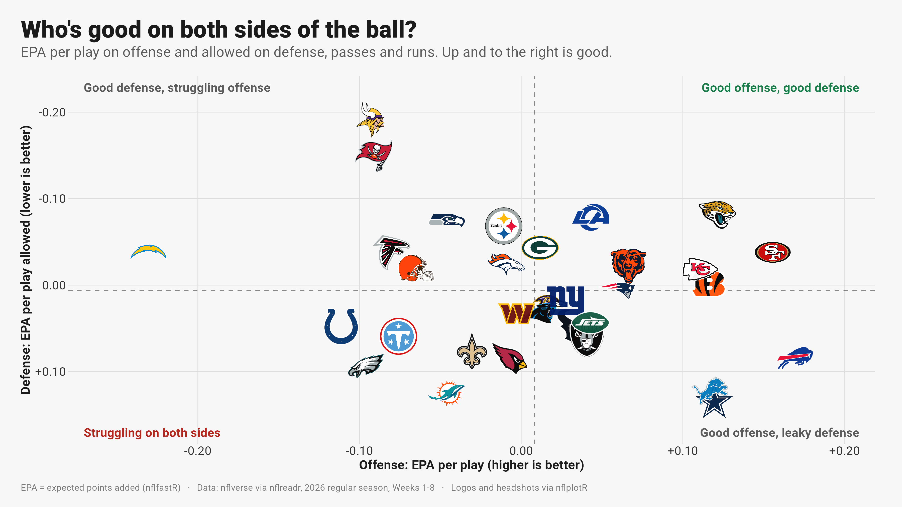
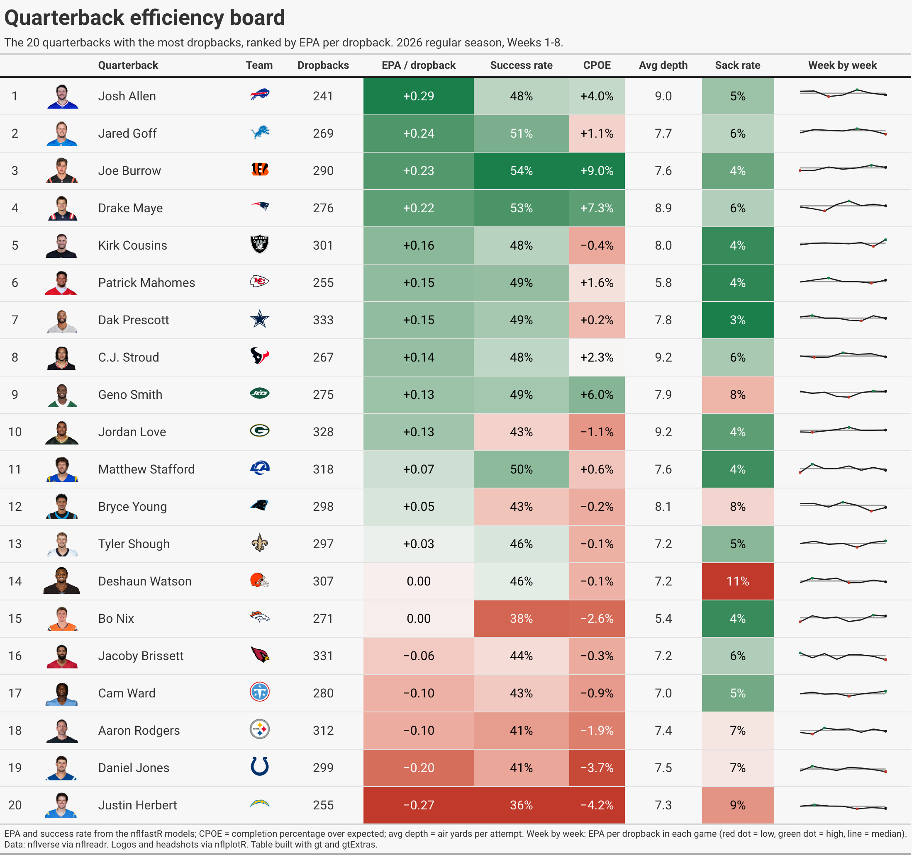
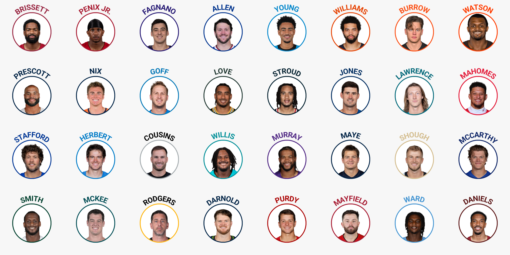

# NFL advanced metrics, visualized

Logo-and-headshot charts of the 2026 NFL season (Weeks 1-8) and of patterns across 2018-2025, built in R from live
nflverse data. Every chart is meant to be read at a glance: a title that states the finding, the metric explained on the
chart, and team logos or player headshots instead of legends. Titles are computed from the data, so a rerun keeps them true.
The style follows Bradley Congelio's *Introduction to NFL Analytics with R* (chapter 4), updated to the current nflverse and
ggplot2 4 APIs.


## Chicago Bears and Caleb Williams

| # | Finding |
|---|---|
| B1 | Caleb Williams went from 30th (2024) to 14th (2025) to 3rd (2026) in EPA per dropback; 2nd in completion % over expected |
| B2 | No current starting QB is both more efficient and more accurate than him (circle headshots for every starter) |
| B3 | He keeps every receiver involved; Rome Odunze turns his targets into the most EPA |
| B4 | He beats expected completion at every depth of throw |
| B5 | D'Andre Swift gets the carries; Kyle Monangai does more with them |
| B6 | Every 2026 Bears game, with the starting quarterback |
| B7 | His sack rate: 9.9% as a rookie, 3.8% in 2025, 7.0% this season |
| B8 | Third downs by head coach: 31st in 2024, 8th in Ben Johnson's first season, 9th so far in 2026 |
| B9 | The defense: 1st in third-down conversions allowed, 28th in yards per play allowed |


## League patterns

| # | Finding |
|---|---|
| P1 | The 2024-25 kickoff changes moved the average kickoff drive start from the 25 to the 30 |
| P2 | Touchdowns above expected don't carry into the second half of a season (r = 0.04); expected touchdowns do (r = 0.44) |
| P2b | 2026 touchdown outliers, over and under expectation |
| P3 | Weeks 1-3 explain about 18% of how a team plays the rest of the season |


## How teams have trended in 2026

| # | Finding |
|---|---|
| T1 | First four weeks vs the next four: the 8 biggest risers (Packers +0.38 net EPA per play) and fallers (Raiders -0.34) |
| T2 | Today's best 8 and worst 8, and how each got there on offense and defense |
| T3 | Every team's season game by game, with a three-game rolling line |
| T4 | Rank in three stretches of the season for the biggest climbers (Giants 29th to 5th) and fallers (49ers 1st to 22nd) |


## The 2026 season

| # | Chart | Metric |
|---|---|---|
| 01 | Who's good on both sides of the ball? | Offensive vs defensive EPA per play, team logos, quadrant labels |
| 02 | Team tiers | Net EPA per play, k-means tiers (`nfl_team_tiers()`) |
| 03 | Who throws more than the situation calls for? | Early-down dropback rate over expected (nflfastR xpass) |
| 04 | The quarterback landscape | EPA per dropback vs CPOE, headshots |
| 05 | Who throws past the sticks on 3rd down? | Share of 3rd-and-5-to-10 throws at or past the marker, headshots on the axis |
| 06 | Focal point of the passing game | Target share vs air-yards share (WOPR) |
| 07 | Who gets fed early? | Share of team 1st-quarter targets |
| 08 | How far downfield does each QB throw? | Air-yards distributions (ridgelines), mean and one SD |
| 09 | Who needs a big play to score? | Touchdown drives with a 20+ yard play |
| 10 | How each NFC North offense has trended | Season-to-date EPA per play after each game |
| 11 | The comeback of the season so far | nflfastR win probability through one game |
| 12 | Who leans on play action, and does it work? | FTN play-action charting vs EPA per play-action dropback |
| 13 | Who's creating yards on the ground? | Next Gen Stats rushing yards over expected per carry |
| 14 | Quarterback efficiency board | gt table: headshots, logos, color scales, weekly sparklines |
| 15 | When does each team score? | Points per game by quarter, heatmap |





All charts are in [`out/`](out/).

## Headshot sprites

`R/02_headshots.R` rebuilds the book's Advanced Headshots Method (section 4.15) on current packages: NFL.com photos via
nflverse, a face-centred square crop (a plain centre crop keeps the chest and clips the hair), `cropcircles::circle_crop()`
with a team-color ring, and the last name on an arc with `geomtextpath`. Groups: every starting QB, the top 32 WRs, 24 RBs
and 16 TEs, all Bears skill players, and the touchdown-outlier players. `assets/headshots/manifest.csv` lists them, and
[`out/headshots/`](out/headshots/) has a contact sheet per group for checking every crop by eye.



## Run it

```bash
scripts/build_all.sh             # everything: data pull, history, headshots, charts, table screenshot
scripts/build_all.sh --charts    # charts only, from the saved data/ snapshot

# one-time: an isolated conda env (the stack below), then CRAN for the nflverse packages
conda create -n nfl_viz -c conda-forge r-base=4.5 r-ggplot2 r-dplyr r-tidyr r-magick r-gt r-gtextras r-ggrepel \
  r-ggtext r-geomtextpath r-patchwork r-ggridges r-ggfx r-s7 r-ragg r-systemfonts r-svglite r-scales compilers make pkg-config
Rscript -e 'install.packages(c("nflreadr", "ggpath", "nflplotR", "cropcircles"), repos = "https://cloud.r-project.org")'

Rscript R/01_data.R                  # pull one snapshot of every table into data/ (asserts every game is final)
Rscript R/01b_history.R              # 2018-2025 play-by-play, expected-touchdown data, 2026 snap counts
Rscript R/02_headshots.R             # headshot sprites for the player groups
Rscript R/run_all.R                  # all charts into out/; or name some: Rscript R/run_all.R epa_landscape qb_table
python scripts/shoot.py "$PWD/out/14_qb_efficiency_board.html" "$PWD/out/14_qb_efficiency_board.png"   # needs Playwright
```

Built and checked on 2026-11-08 with R 4.5.3, ggplot2 4.0.3, nflplotR 1.7.1, nflreadr 1.5.1, ggpath 1.1.2, gt 1.4.0,
gtExtras 0.6.2, ggtext 0.2.0, cropcircles 0.2.4, geomtextpath 0.2.0, ggrepel 0.9.8, ggridges 0.5.7, ggfx 1.0.3, ragg 1.5.2. Every installed package matched CRAN's latest that
day. R 4.6 was skipped because conda-forge had not yet built ggplot2 4 for it. Fonts: Roboto (SIL OFL 1.1, `fonts/`),
registered locally.

## Current practice vs the book

| Book (2023-24) | Now |
|---|---|
| `geom_image(aes(image = team_logo_wikipedia), asp = 16/9)` | `nflplotR::geom_nfl_logos(aes(team_abbr = team))` |
| `geom_mean_lines(aes(v_var = , h_var = ))` | `geom_mean_lines(aes(x0 = , y0 = ))` (nflplotR 1.2.0) |
| `scale_x_nfl()`, `theme_x_nfl()` | `element_nfl_logo()`, `element_nfl_headshot()` (removed in 1.4.0) |
| `geom_line(size = )`, `stat_summary(fun.y = )` | `linewidth`, `fun` (ggplot2 3.4 / 3.3) |
| `load_player_stats(stat_type = )` | `summary_level =` (nflreadr 1.5.0) |
| Frozen 2022 CSVs from the book's site | Live `nflreadr::load_pbp()`, `load_nextgen_stats()`, `load_ftn_charting()` |
| nflfastR 4-5 win probability | nflfastR 6.0.0 (2026-09-18) rebuilt the overtime model |
| Old Titans and Rams marks | nflplotR 1.7.0 carries the 2026 rebrands |

**One gotcha found while building this:** under ggplot2 4.0.3 / nflplotR 1.7.1 / ggpath 1.1.2, `element_nfl_logo()` and
`element_nfl_headshot()` draw nothing when the plot carries a complete theme (`theme_minimal() + theme(axis.text.x =
element_nfl_headshot())`), with `+` or `%+replace%`, and print no warning. A partial `theme()` layered on ggplot2's default
works, so `theme_nfl()` in `R/00_setup.R` is built that way (as the book's own theme is).

## Data and credits

- Play-by-play, EPA, CPOE, expected pass and win probability: nflverse (nflfastR models) via nflreadr.
- Play-action charting: FTN Data via nflverse (CC BY-SA 4.0).
- Rushing yards over expected: NFL Next Gen Stats via nflverse.
- Team logos and player headshots via nflplotR. They are the trademarks and images of the NFL, its teams and players.
- Chart style after Bradley J. Congelio, *Introduction to NFL Analytics with R* (CC0).
