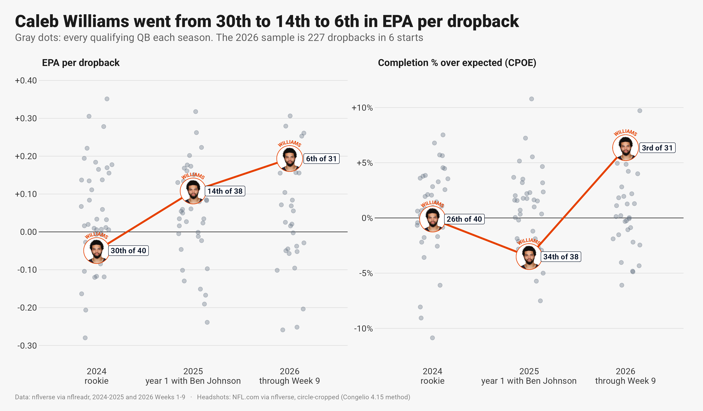
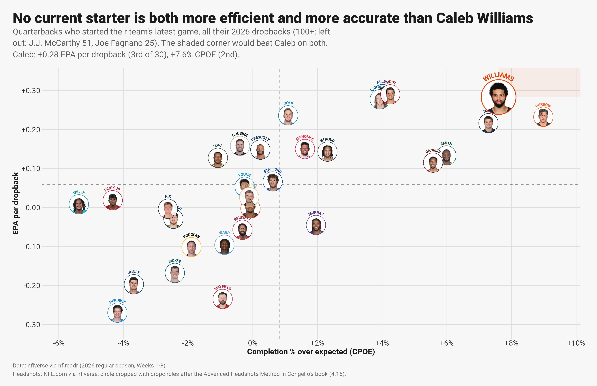
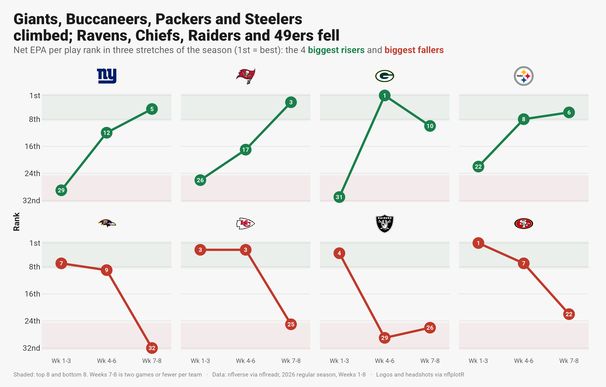
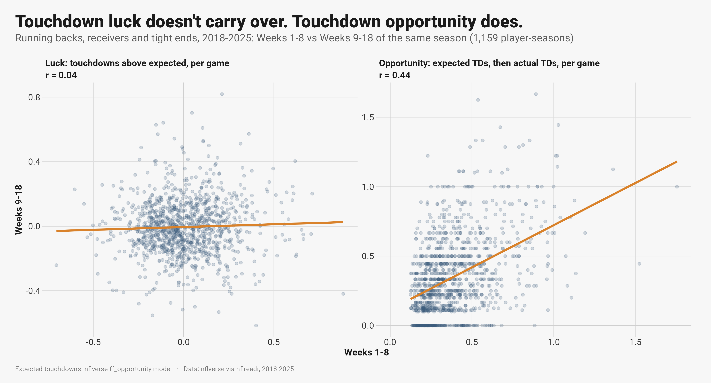

# NFL advanced metrics, visualized

Thirty-two charts of the 2026 NFL season and of patterns across 2018-2025, built in R from nflverse data. Each one is
meant to be read in five seconds: the title states the finding, a one-line subtitle says what is measured, and team logos
or player headshots replace legends. Titles are computed from the data, so a rerun after next week keeps them true. The
style follows Bradley Congelio's *Introduction to NFL Analytics with R* (chapter 4), rebuilt on the current nflverse and
ggplot2 4 APIs.

Data through 2026 Week 8. Rebuild everything with one command (`scripts/build_all.sh`).



## What the charts say

- **Caleb Williams went from 30th to 14th to 3rd in EPA per dropback** over three seasons, and is 2nd in completion
  percentage over expected. No current starter beats him on both (B1, B2). His sack rate went 9.9%, 3.8%, 7.0% (B7).
- **Ben Johnson fixed third down:** the Bears went from 31st in 2024 to 8th in his first season, and are 9th now (B8).
  The defense is the mirror image: 1st in third-down stops, 28th in yards per play allowed (B9).
- **Touchdown luck doesn't carry over; opportunity does.** Scoring more than expected in Weeks 1-8 says almost nothing
  about Weeks 9-18 (r = 0.04); expected touchdowns do (r = 0.44). 1,159 player-seasons (P2).
- **Three weeks explain only 18%** of how a team plays the rest of the season (r = 0.42, 256 team-seasons) (P3).
- **The new kickoff gave every offense about 5 free yards:** drives start at the 30 instead of the 25, and 59-60% cross
  midfield instead of 53% (P1, 22,043 drives).
- **2026 movers:** the Giants went from 29th to 5th in net EPA per play and the Buccaneers from 26th to 3rd; the 49ers
  fell from 1st to 22nd and the Ravens from 7th to 32nd (T4).

## Charts

**Chicago Bears and Caleb Williams**

| # | Finding |
|---|---|
| B1 | 30th (2024) to 14th (2025) to 3rd (2026) in EPA per dropback |
| B2 | No current starter is both more efficient and more accurate (circle headshots) |
| B3 | He keeps every receiver involved; Rome Odunze turns targets into the most EPA |
| B4 | He beats expected completion at every depth of throw |
| B5 | D'Andre Swift gets the carries; Kyle Monangai does more with them |
| B6 | Every 2026 game with the starting quarterback: 4-1 with Caleb |
| B7 | Sack rate by season |
| B8 | Third downs by head coach, 2018-2026 |
| B9 | Defensive rank on six measures |

**How teams have trended in 2026**

| # | Finding |
|---|---|
| T1 | First four weeks vs the next four: the 8 biggest risers and fallers |
| T2 | Today's best 8 and worst 8, and how each got there on offense and defense |
| T3 | Every team's season, game by game, with a three-game rolling line |
| T4 | Rank in three stretches of the season, one panel per team |

**League patterns:** P1 kickoff rule, P2 touchdown regression, P2b 2026 touchdown outliers, P3 early weeks vs the rest.

**The 2026 season (01-15):** team EPA landscape, tiers, early-down pass rate over expected, the QB landscape, third-down
aggressiveness, target share vs air-yards share, 1st-quarter targets, QB throw-depth ridgelines, big-play touchdown drives,
the NFC North trend, the comeback of the season, play action (FTN charting), rushing yards over expected (Next Gen Stats), a
gt QB board with sparklines, and points by quarter.







All charts: [`out/`](out/).

## How it's built

- **One frozen snapshot per run.** `R/01_data.R` pulls 2026 play-by-play, schedules, rosters, Next Gen Stats and FTN
  charting, and stops if any scheduled game isn't final. `R/01b_history.R` adds 2018-2025 play-by-play (slim columns),
  nflverse expected-touchdown data, snap counts and schedules. Charts read only `data/`, so they rebuild offline.
- **Headshots, the book's section 4.15 method on current packages** (`R/lib_headshots.R`): NFL.com photos via nflverse,
  a face-centred square crop first (a plain centre crop keeps the chest and clips the hair), `cropcircles` with a ring in
  the team color, and the last name arced over the top with `geomtextpath`. 136 players in seven groups (starting QBs, top
  WRs, RBs and TEs, Bears and Bucs skill players, touchdown outliers). Contact sheets in [`out/headshots/`](out/headshots/)
  show every crop.
- **Text that can't go stale.** Titles are built from the numbers (computed ranks and values), never typed. Subtitles are
  one line, with colored bold words doing the legend's job (`ggtext`). `save_chart()` flags a subtitle that would wrap.
- **Less clutter.** Busy scatters show headshots only for the players the title is about and gray dots for the rest; a
  small repel (`spread_xy()` in `R/00_setup.R`) nudges overlapping headshots apart with a leader line to the true point.
  On line charts, `line_label_pos()` puts each point label where the line can't run through it: below a valley, beside a
  rise or a fall, above a peak.
- **Checked by eye.** Every chart was viewed after every change; clipped titles, overlapping labels and crossed arrows were
  fixed in code, not by hand.

## Engineering notes

- **Axis logos and headshots vanish under a complete theme.** With ggplot2 4.0.3, nflplotR 1.7.1 and ggpath 1.1.2,
  `element_nfl_logo()` and `element_nfl_headshot()` draw nothing when the plot uses `theme_minimal()` (with `+` or
  `%+replace%`), and nothing warns. `theme_nfl()` is a partial `theme()` on ggplot2's default, as the book's own theme is.
- **The font is registered under its own name** (`RobotoNFL`): registering it as "Roboto" collides with a system copy.
- **R 4.5.3, not 4.6:** conda-forge had no ggplot2 4 build for R 4.6 yet. Packages compiled from CRAN need conda's
  `compilers` in the env and `SDKROOT` set; every package matched CRAN's latest on 2026-11-08.
- **The gt board is HTML.** `scripts/shoot.py` screenshots it with Playwright at 2x.

| Book (2023-24) | Now |
|---|---|
| `geom_image(aes(image = team_logo_wikipedia), asp = 16/9)` | `nflplotR::geom_nfl_logos(aes(team_abbr = team))` |
| `geom_mean_lines(aes(v_var = , h_var = ))` | `geom_mean_lines(aes(x0 = , y0 = ))` (nflplotR 1.2.0) |
| `scale_x_nfl()`, `theme_x_nfl()` | `element_nfl_logo()`, `element_nfl_headshot()` (removed in 1.4.0) |
| `geom_line(size = )`, `stat_summary(fun.y = )` | `linewidth`, `fun` |
| `load_player_stats(stat_type = )` | `summary_level =` (nflreadr 1.5.0) |
| Frozen 2022 CSVs from the book's site | live `load_pbp()`, `load_nextgen_stats()`, `load_ftn_charting()` |
| nflfastR 4-5 win probability | nflfastR 6.0.0 rebuilt the overtime model (2026-09-18) |
| Old Titans and Rams marks | nflplotR 1.7.0 carries the 2026 rebrands |

## Run it

```bash
scripts/build_all.sh                        # data pull, history, headshots, every chart, the gt board screenshot
scripts/build_all.sh --charts               # charts only, from the saved snapshot
Rscript R/run_all.R caleb_leap trend_bump   # named charts only (chart_<name> functions in R/charts_*.R)
```

One-time setup:

```bash
conda create -n nfl_viz -c conda-forge r-base=4.5 r-ggplot2 r-dplyr r-tidyr r-magick r-gt r-gtextras r-ggrepel \
  r-ggtext r-geomtextpath r-patchwork r-ggridges r-ggfx r-s7 r-ragg r-systemfonts r-svglite r-scales compilers make pkg-config
Rscript -e 'install.packages(c("nflreadr", "ggpath", "nflplotR", "cropcircles"), repos = "https://cloud.r-project.org")'
```

Versions on 2026-11-08: R 4.5.3, ggplot2 4.0.3, nflplotR 1.7.1, nflreadr 1.5.1, ggpath 1.1.2, gt 1.4.0, gtExtras 0.6.2,
ggtext 0.2.0, cropcircles 0.2.4, geomtextpath 0.2.0, ragg 1.5.2. `build_all.sh` reads `RSCRIPT` and `PLAYWRIGHT_PY` (from the
environment or an untracked `scripts/local.env`) to point at other installs.

```
R/00_setup.R        theme, fonts, caption, save_chart(), spread_xy(), shared helpers
R/01_data.R         2026 snapshot (asserts every game is final)
R/01b_history.R     2018-2025 play-by-play, expected touchdowns, snap counts, schedules
R/02_headshots.R    headshot groups -> assets/headshots/manifest.csv + contact sheets
R/lib_headshots.R   crop, ring, name arc; ensure_sprite() for any player
R/charts_*.R        one chart_<name>() per chart: teams, qbs, players, games, bears, patterns, trends, table
R/run_all.R         runs every chart_*() (or the ones named)
scripts/            build_all.sh, shoot.py (gt -> PNG)
out/                charts (PNG) and the gt board (HTML)
fonts/              Roboto, SIL OFL 1.1
```

## Limits

- Net EPA per play is not adjusted for opponents. 2026 samples are small: Caleb's 2026 line is 186 dropbacks in 5 starts,
  and the Weeks 7-8 stretch in T4 is two games or fewer per team. The charts say so where it matters.
- EPA, CPOE, expected pass rate and win probability are nflfastR model outputs; expected touchdowns are nflverse's
  ff_opportunity model; rushing yards over expected are Next Gen Stats.
- nflverse credits all of the 2024 Bears season to Matt Eberflus; Thomas Brown coached the last five games as interim.

## Data and credits

Play-by-play and models: nflverse (nflfastR) via nflreadr. Play-action charting: FTN Data via nflverse (CC BY-SA 4.0).
Rushing yards over expected: NFL Next Gen Stats via nflverse. Team logos and player photos via nflplotR and NFL.com; they
are the trademarks and images of the NFL, its teams and players, used for commentary and analysis. Chart style after
Bradley J. Congelio, *Introduction to NFL Analytics with R* (CC0). Code: MIT ([LICENSE](LICENSE)).
